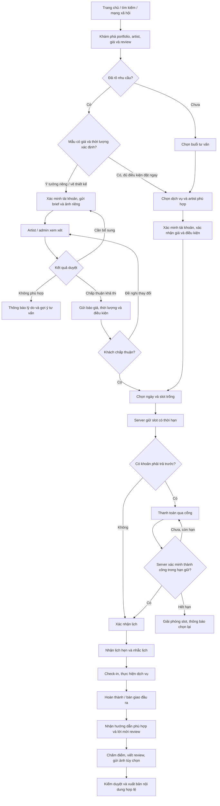
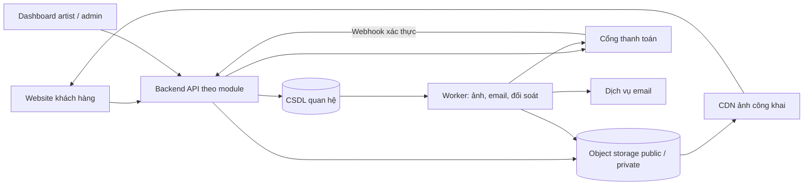
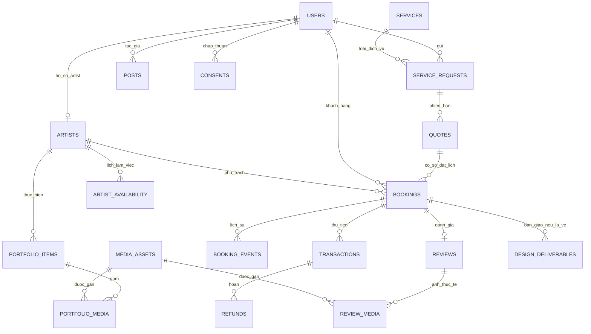

# PRD — Nền tảng đặt lịch vẽ thiết kế, xăm hình và Portfolio

| Thuộc tính | Nội dung |
| --- | --- |
| Phiên bản | 1.0 — Đề xuất sản phẩm để thống nhất phạm vi và triển khai |
| Ngày lập | 10/10/2026 |
| Đối tượng sử dụng | Chủ studio, Product Owner, BA, UX/UI, lập trình viên, QA và nhân sự vận hành |
| Mô hình ra mắt | Một studio, nhiều nghệ sĩ; website ưu tiên trải nghiệm trên điện thoại |
| Thị trường giả định | Việt Nam; tiếng Việt; tiền tệ VND; múi giờ hiển thị `Asia/Ho_Chi_Minh` |
| Phạm vi tài liệu | Yêu cầu sản phẩm, nghiệp vụ, dữ liệu, tiêu chí nghiệm thu và lộ trình; chưa phải thiết kế kỹ thuật chi tiết |

> Các mức cọc, thời hạn, giá ví dụ, chỉ tiêu kinh doanh và tiến độ trong tài liệu là **đề xuất ban đầu**, chưa phải chính sách studio đã phê duyệt. Các quyết định cần chốt được tập hợp tại mục 7. Đây là sản phẩm độc lập; tài liệu không giả định phải tích hợp với các hệ thống trong workspace hiện tại.

## 0. Tổng quan sản phẩm

### 0.1. Vấn đề và giá trị mang lại

Khách thường tìm mẫu trên mạng xã hội, hỏi giá qua tin nhắn, trao đổi ý tưởng rời rạc và phải nhờ nhân viên kiểm tra lịch. Studio khó liên kết mẫu tham khảo, báo giá, tiền cọc và lịch của từng artist; khách cũng thiếu nơi theo dõi thống nhất.

Sản phẩm đưa toàn bộ hành trình **khám phá → tư vấn/báo giá → đặt lịch → đặt cọc → thực hiện → đánh giá** về một nơi:

- **Khách hàng:** tìm được phong cách phù hợp, hiểu giá và điều kiện trước khi trả tiền, theo dõi lịch hẹn rõ ràng.
- **Artist:** nhận brief đầy đủ, chủ động thời lượng và lịch làm việc, quản lý tác phẩm và phản hồi.
- **Studio:** giảm thao tác thủ công, tránh trùng lịch, kiểm soát cọc/hoàn tiền và xây dựng uy tín qua tác phẩm thực tế.

### 0.2. Phân biệt ba loại dịch vụ

| Loại dịch vụ | Đầu vào | Kết quả cung cấp | Cách đặt lịch MVP |
| --- | --- | --- | --- |
| `CONSULTATION` — Tư vấn | Nhu cầu, vị trí, kích thước dự kiến, ảnh tham khảo nếu có | Buổi tư vấn; kết luận khả thi và hướng xử lý tiếp theo | Slot cố định, mặc định 30 phút, miễn phí; studio có thể cấu hình thu phí |
| `DESIGN` — Vẽ thiết kế riêng | Brief, phong cách, vị trí, kích thước, yêu cầu quyền sử dụng | Bản vẽ theo đầu ra, hạn bàn giao và số vòng sửa đã thỏa thuận | Duyệt brief và báo giá; đặt buổi làm việc với artist; theo dõi bàn giao file |
| `TATTOO` — Thực hiện xăm | Mẫu flash đủ điều kiện hoặc thiết kế/ý tưởng đã duyệt | Một buổi thực hiện xăm | Mẫu đủ giá và thời lượng được đặt trực tiếp; ý tưởng riêng cần duyệt trước |

**Flash** là mẫu studio đã chuẩn bị sẵn. Một ảnh portfolio không tự động trở thành mẫu flash được đặt ngay. Mua bản vẽ không mặc nhiên bao gồm dịch vụ xăm, quyền thương mại hoặc chuyển nhượng bản quyền. MVP không tự khấu trừ phí vẽ vào tiền xăm; nếu studio áp dụng, khoản giảm phải xuất hiện riêng trên báo giá xăm.

Mỗi booking MVP gồm **một khách, một dịch vụ, một artist và một buổi hẹn**. Với thiết kế, booking còn theo dõi đầu ra sau buổi làm việc; thời gian vẽ ngoài buổi hẹn được artist quản lý qua hạn bàn giao. Dự án nhiều buổi được studio tạo từng booking liên kết; tự động quản lý liệu trình thuộc Phase 2.

### 0.3. Chỉ tiêu sản phẩm đề xuất

Đo baseline trong bốn tuần đầu và đánh giá lại sau tám tuần vận hành. Các mục tiêu dưới đây là giả thuyết để kiểm chứng, không phải dự báo doanh thu.

| Chỉ tiêu | Định nghĩa | Mục tiêu ban đầu |
| --- | --- | --- |
| Hoàn tất bước đặt cọc | Booking xác nhận có cọc / booking bắt đầu thanh toán, loại dữ liệu thử nghiệm | ≥ 70% |
| Tốc độ phản hồi brief | Thời gian từ gửi brief đến phản hồi đầu tiên của studio, tính theo giờ làm việc | 90% trong một ngày làm việc |
| Không đến | Booking `NO_SHOW` / tổng booking đã đến thời điểm thực hiện, loại lịch đã hủy | ≤ 10% |
| Tỷ lệ có review | Booking hoàn thành có review được gửi / booking hoàn thành đủ 30 ngày | ≥ 25% |
| Sai lệch vận hành nghiêm trọng | Trùng lịch xác nhận hoặc ghi nhận một khoản thu nhiều lần | 0 trường hợp |

Sự kiện phân tích gồm: `portfolio_view`, `filter_apply`, `booking_start`, `brief_submit`, `quote_accept`, `slot_hold_created`, `payment_start`, `booking_confirmed`, `booking_cancelled`, `service_completed`, `review_submitted`. Mỗi sự kiện chuyển đổi chỉ được tính một lần theo đối tượng; không gửi nội dung brief, ảnh, email hoặc điện thoại vào công cụ phân tích.

## 1. Phân tích người dùng và luồng trải nghiệm

### 1.1. User Personas

| Nhóm | Nhu cầu chính | Khó khăn | Tính năng phục vụ | Dấu hiệu thành công |
| --- | --- | --- | --- | --- |
| Khách vãng lai | Tìm cảm hứng, hiểu phong cách và mức giá | Quá nhiều ảnh, khó phân biệt ảnh tham khảo với tác phẩm thực tế | Portfolio, bộ lọc, hồ sơ artist, giá tham khảo, blog | Tìm được mẫu/artist và bắt đầu yêu cầu |
| Khách xăm lần đầu | Được hướng dẫn và biết tổng chi phí | Chưa biết kích thước, thời lượng hoặc cách chuẩn bị | Luồng tư vấn, giải thích thuật ngữ, báo giá rõ ràng, aftercare | Hiểu điều kiện và đặt lịch thành công |
| Khách đã có ý tưởng | Chọn đúng artist, trao đổi thiết kế riêng | Khó truyền đạt yêu cầu và theo dõi các lần sửa | Upload brief, báo giá có phiên bản, bàn giao bản vẽ | Chấp thuận thiết kế và lịch phù hợp |
| Khách quay lại | Đặt lại nhanh, xem lịch sử và đánh giá | Thông tin cũ phân tán, phải cung cấp lại nhiều lần | Tài khoản, lịch sử booking, đặt tiếp từ dịch vụ cũ | Hoàn thành đặt lịch với ít thao tác |
| Artist | Lịch làm việc hợp lý, brief rõ, kiểm soát chất lượng tác phẩm | Trùng lịch, ước lượng thiếu thời gian, thay đổi yêu cầu | Dashboard lịch, duyệt brief, báo giá, bàn giao, portfolio | Ít xung đột, biết việc cần xử lý mỗi ngày |
| Admin/Chủ studio | Quản lý công suất, tiền và chất lượng dịch vụ | Khó đối soát cọc, xử lý hủy/hoàn và nội dung | Dashboard toàn studio, phân quyền, giao dịch, kiểm duyệt, báo cáo | Lịch và dòng tiền truy vết được |

### 1.2. Phân quyền chính

| Chức năng | Khách vãng lai | Khách đã xác minh | Artist | Admin |
| --- | --- | --- | --- | --- |
| Xem nội dung công khai | Có | Có | Có | Có |
| Gửi brief, tải ảnh riêng, đặt lịch | Cần xác minh | Hồ sơ của mình | Theo vai trò khách nếu có | Tạo hộ khách có ghi nhận nguồn |
| Xem brief, ảnh và booking riêng | Không | Của mình | Được phân công | Trong phạm vi quyền vận hành |
| Duyệt khả thi, lập báo giá | Không | Không | Yêu cầu được giao, trong quyền cho phép | Có |
| Quản lý lịch làm việc | Không | Không | Lịch của mình, không ghi đè booking | Toàn studio |
| Check-in, bắt đầu, hoàn thành dịch vụ | Không | Không | Booking của mình | Có |
| Tạo/sửa portfolio, bản nháp bài viết | Không | Không | Nội dung của mình | Có |
| Xuất bản nội dung, kiểm duyệt review | Không | Không | Gửi duyệt, trả lời review được giao | Có |
| Duyệt hoàn tiền, xác nhận thu tại quầy | Không | Gửi yêu cầu | Xem trạng thái cần thiết | Quyền tài chính riêng |
| Đổi chính sách, vai trò, xuất báo cáo tài chính | Không | Không | Không | Quyền quản trị tương ứng |

Một người có thể mang nhiều vai trò. Backend kiểm tra quyền theo từng đối tượng, không chỉ theo việc giao diện có hiển thị nút hay không. Artist không được tự cấp quyền admin hoặc xem toàn bộ danh sách khách hàng.

### 1.3. Luồng trải nghiệm tổng thể

Tiền nhận sau khi slot hết hạn đi vào quy trình hoàn tiền tại mục 2.7; sơ đồ không coi thanh toán muộn là đặt lịch thành công.

### 1.4. Các luồng cần thiết kế riêng

1. **Tư vấn:** chọn artist → xác nhận dịch vụ 30 phút → chọn slot → xác nhận miễn phí hoặc trả khoản yêu cầu → nhận hướng dẫn tham dự. Kết thúc tư vấn không tự tạo booking xăm.
2. **Vẽ thiết kế:** brief → artist đánh giá → báo giá đầu ra/số vòng sửa/hạn giao → khách đồng ý → chọn buổi làm việc và trả cọc → xem bản nháp → phản hồi trong phạm vi → chấp thuận và nhận bản cuối. Muốn xăm phải tạo booking xăm riêng, có liên kết với yêu cầu cũ.
3. **Xăm flash:** chọn đúng biến thể kích thước/vị trí/artist đã cấu hình → giá và thời lượng xác định → chọn slot → cọc → xác nhận. Thay đổi ngoài biến thể cho phép chuyển sang luồng duyệt.
4. **Xăm theo ý tưởng riêng:** gửi ảnh và brief → có thể được yêu cầu tư vấn → chốt phạm vi, giá, thời lượng → khách chấp thuận → mới chọn slot và cọc.
5. **Hủy/dời:** mở lịch hẹn → xem điều kiện và số tiền dự kiến → xác nhận yêu cầu → nhận kết quả riêng cho lịch và hoàn tiền. Dời thất bại giữ nguyên lịch cũ.
6. **Không có slot:** cho đổi ngày hoặc chọn artist khác; đổi artist có thể cần báo giá lại. MVP cung cấp yêu cầu studio hỗ trợ, danh sách chờ tự động thuộc Phase 2.

## 2. Yêu cầu chức năng

### 2.1. Quy ước ưu tiên và cấu trúc màn hình

- **M0:** bắt buộc để vận hành MVP; là điều kiện nghiệm thu ra mắt.
- **M1:** cải thiện trong giai đoạn ổn định sau MVP; không chặn ra mắt.
- **P2:** tính năng mở rộng Phase 2.

| Phân hệ | Màn hình chính |
| --- | --- |
| Website công khai | Trang chủ; portfolio và chi tiết tác phẩm; artist và hồ sơ; bảng giá; blog/aftercare; giới thiệu, liên hệ, chính sách |
| Khu vực khách hàng | Xác minh/đăng nhập; wizard gửi yêu cầu; báo giá; chọn slot; thanh toán; lịch của tôi; chi tiết lịch; bản vẽ; review |
| Dashboard artist | Tổng quan việc cần xử lý; lịch ngày/tuần; brief và báo giá; khách của lịch được giao; portfolio; bàn giao thiết kế |
| Dashboard admin | Tổng quan studio; artist/dịch vụ/giá; lịch và booking; thu/hoàn tiền; kiểm duyệt; bài viết; người dùng/quyền; cấu hình và audit |

Wizard đặt lịch hiển thị tiến độ, bước hiện tại và nút quay lại. Khi quay lại, giữ dữ liệu đã nhập nhưng phải kiểm tra lại giá, quyền truy cập và slot trước khi thanh toán.

### 2.2. Trang chủ, portfolio và tìm kiếm

| Mã | Yêu cầu | Logic và tiêu chí chính | Ưu tiên |
| --- | --- | --- | --- |
| FR-P01 | Trang chủ | Giới thiệu studio, phong cách nổi bật, tác phẩm được chọn, artist, review công khai và CTA đặt lịch/tư vấn | M0 |
| FR-P02 | Danh sách portfolio | Phân trang hoặc “Xem thêm”; chỉ lấy tác phẩm đã xuất bản; ảnh có mô tả thay thế | M0 |
| FR-P03 | Bộ lọc | Phong cách, vị trí, artist, loại ảnh; tìm theo tên/mô tả/thẻ; lưu bộ lọc trên URL để chia sẻ | M0 |
| FR-P04 | Chi tiết tác phẩm | Album, artist thực hiện, phong cách, vị trí, kích thước tham khảo, chú thích và CTA liên quan | M0 |
| FR-P05 | Ảnh trước/sau | Nhóm ảnh cùng ca, nhãn `BEFORE`, `AFTER`, `HEALED`, ngày chụp nếu có; không ghép hai khách khác nhau | M0 |
| FR-P06 | Hồ sơ artist | Tên nghề nghiệp, giới thiệu, chuyên môn, tác phẩm, review hợp lệ và trạng thái nhận lịch | M0 |
| FR-P07 | Mẫu có thể đặt | Tác phẩm được đánh dấu flash, có dịch vụ/biến thể hợp lệ mới có nút “Đặt mẫu này”; còn lại “Tư vấn mẫu tương tự” | M0 |
| FR-P08 | Yêu thích | Lưu tác phẩm để xem lại; đồng bộ tài khoản khi đăng nhập | M1 |

Quy tắc lọc: các nhóm điều kiện kết hợp **AND**; nhiều giá trị trong cùng nhóm kết hợp **OR**. Ví dụ “Fine line hoặc Minimalism” và “Cổ tay” và “Artist A”. Khi rỗng, hiển thị điều kiện đang chọn và nút bỏ lọc. MVP ưu tiên danh mục quản lý tập trung để tránh các thẻ trùng nghĩa.

Ảnh portfolio phải phân biệt tác phẩm đã thực hiện, bản vẽ và ảnh tham khảo. Không gắn artist studio là tác giả của ảnh tham khảo từ bên ngoài. MVP chỉ cho đặt trực tiếp flash được phép thực hiện nhiều lần; quản lý quyền bán mẫu độc bản thuộc Phase 2.

### 2.3. Bảng giá và báo giá

| Mã | Yêu cầu | Logic và tiêu chí chính | Ưu tiên |
| --- | --- | --- | --- |
| FR-PR01 | Bảng giá công khai | Có loại dịch vụ, kích thước theo cm, phong cách, mức phức tạp, đơn vị tính và ngày hiệu lực | M0 |
| FR-PR02 | Loại giá | `FIXED` — cố định; `FROM` — từ mức; `RANGE` — khoảng; `QUOTE_REQUIRED` — cần tư vấn | M0 |
| FR-PR03 | Công bố chi phí | Ghi rõ đã/chưa gồm thuế và phụ phí nếu áp dụng; phí vẽ, tư vấn, dặm lại phải có điều kiện cụ thể | M0 |
| FR-PR04 | Báo giá cá nhân | Chốt artist, dịch vụ, hạng mục, tổng giá, khoản trả trước, thời lượng, buffer, hiệu lực và chính sách | M0 |
| FR-PR05 | Phiên bản và đồng ý | Giá/phạm vi/thời lượng thay đổi tạo phiên bản mới; lưu người gửi, khách đồng ý và thời điểm | M0 |
| FR-PR06 | Ước tính nâng cao | Bộ ước tính tương tác theo thông số, vẫn phân biệt ước tính với giá được studio xác nhận | P2 |

Giá `FROM`, `RANGE` và giá theo giờ chỉ có giá trị tham khảo. MVP yêu cầu studio chuyển thành báo giá có **tổng tiền và thời lượng xác định** trước khi mở thanh toán. Không tự nhân hệ số kích thước × phong cách × độ phức tạp nếu studio chưa định nghĩa quy tắc.

Với flash/tư vấn được đặt trực tiếp, backend tự tạo `ServiceRequest` tối giản và một `Quote` snapshot từ biến thể đang hiệu lực; khách chấp thuận tại bước xác nhận, không cần artist duyệt thủ công. Áp dụng cả tư vấn 0 đồng để mọi booking đều lưu thống nhất artist, giá, thời lượng và chính sách. Trước khi có hold, thay đổi cấu hình làm quote cũ không còn hợp lệ phải được thông báo để khách xác nhận bản mới.

**Ví dụ dữ liệu minh họa, không phải bảng giá thị trường:**

| Dịch vụ | Điều kiện ví dụ | Hiển thị giá | Hành động |
| --- | --- | --- | --- |
| Tư vấn | 30 phút, tại studio | 0 đồng | Chọn lịch |
| Flash A | Đen trắng, tối đa 5 × 5 cm, vị trí và artist trong danh sách | Cố định 1.000.000 đồng | Chọn lịch khi cấu hình thời lượng đầy đủ |
| Thiết kế riêng | Một phương án, một vòng sửa, đầu ra PNG/JPEG | Cần báo giá | Gửi brief |
| Cover-up | Tùy hình hiện tại và khả năng thực hiện | Cần tư vấn | Gửi ảnh riêng hoặc đặt tư vấn |

Mẫu báo giá thiết kế phải có: phạm vi, số phương án, số vòng sửa, hạn bàn giao, định dạng/độ phân giải đầu ra, quyền sử dụng, các mốc tính phí đã thực hiện và điều kiện hủy sau khi bắt đầu vẽ. File nguồn chỉnh sửa chỉ được bàn giao nếu có trong phạm vi; MVP không cần hỗ trợ định dạng file thiết kế chuyên dụng.

### 2.4. Tài khoản, brief và upload ý tưởng

| Mã | Yêu cầu | Logic và tiêu chí chính | Ưu tiên |
| --- | --- | --- | --- |
| FR-U01 | Xác minh khách | MVP dùng mã/link đăng nhập email có thời hạn; tạo tài khoản tối thiểu sau xác minh; số điện thoại liên hệ nhập riêng | M0 |
| FR-U02 | Hồ sơ tối thiểu | Tên hiển thị, email đã xác minh, điện thoại liên hệ; không công khai thông tin liên hệ | M0 |
| FR-U03 | Brief | Loại dịch vụ, phong cách, vị trí, kích thước mong muốn, màu sắc, mô tả, artist ưu tiên, ngân sách tùy chọn | M0 |
| FR-U04 | Upload ảnh | Tối đa 5 ảnh/brief, 10 MB/ảnh; JPEG/PNG/WebP; xem trước, xóa/thay trước khi gửi | M0 |
| FR-U05 | Theo dõi yêu cầu | Xem trạng thái, phản hồi cần bổ sung, báo giá và lịch sử trao đổi theo yêu cầu | M0 |
| FR-U06 | Điều khoản và ảnh | Đồng ý điều khoản dịch vụ; đồng ý đăng ảnh/quảng bá và marketing là lựa chọn riêng, mặc định tắt | M0 |

Ảnh HEIC/HEIF chưa hỗ trợ trong MVP phải được báo rõ trước upload hoặc hướng dẫn xuất JPEG; chuyển đổi trực tiếp trên hệ thống là M1. Ảnh không đạt kiểm tra không được đính kèm vào brief đã gửi. Khách có thể lưu nháp mà không giữ lịch.

Đề xuất chính sách studio chỉ nhận khách từ 18 tuổi: tự xác nhận trước đặt lịch và kiểm tra trực tiếp khi cần; **đây là chính sách sản phẩm cần studio chốt, không phải kết luận về yêu cầu pháp luật**. MVP không lưu bản chụp giấy tờ hoặc hồ sơ sức khỏe chi tiết. Trường hợp cần đánh giá trực tiếp được chuyển sang tư vấn.

### 2.5. Duyệt yêu cầu và quy trình thiết kế

1. Khách gửi yêu cầu; hệ thống tạo mã và thông báo “Đã nhận yêu cầu, chưa xác nhận lịch”.
2. Admin phân công artist; artist xem brief, yêu cầu bổ sung, đề nghị tư vấn hoặc từ chối kèm lý do phù hợp.
3. Artist lập báo giá. Admin phê duyệt nếu artist không có quyền gửi trực tiếp; MVP cấu hình quyền này theo vai trò.
4. Báo giá được gửi có hiệu lực mặc định 72 giờ. Trong thời gian chờ khách chấp thuận chưa giữ slot.
5. Khách chấp thuận phiên bản hiện hành hoặc đề nghị sửa. Báo giá được sửa phải có phiên bản mới; phiên bản cũ không dùng tạo checkout mới.
6. Với `DESIGN`, báo giá ghi ngày bắt đầu dự kiến và hạn bàn giao; artist phải kiểm tra khối lượng công việc ngoài lịch hẹn trước khi gửi.
7. Sau booking và khoản trả trước hợp lệ, artist thực hiện, tải bản xem trước có watermark, nhận phản hồi và đếm vòng sửa theo báo giá.
8. Phát sinh ngoài phạm vi phải được khách chấp thuận báo giá bổ sung trước khi thực hiện. MVP xử lý như yêu cầu/booking bổ sung có liên kết, không sửa âm thầm giá đã nhận cọc.
9. Khách chấp thuận bản cuối; studio xác minh đã thu đủ phí thiết kế rồi mở quyền tải bản không watermark. Hoàn thành khi ghi nhận bàn giao; lưu phiên bản file và thời điểm.
10. Khách không phản hồi thì gửi nhắc và đưa vào danh sách admin cần xử lý; không tự coi là nghiệm thu chỉ vì đã qua một số ngày.

Nghiệp vụ upload bản nháp, phản hồi văn bản và bàn giao file thuộc MVP. Vẽ chú thích trực tiếp, so sánh phiên bản và cộng tác thời gian thực thuộc Phase 2.

### 2.6. Lịch làm việc, slot trống và xác nhận booking

| Mã | Yêu cầu | Logic và tiêu chí chính | Ưu tiên |
| --- | --- | --- | --- |
| FR-B01 | Lịch artist | Giờ làm theo tuần, khoảng nghỉ, ngày nghỉ, giờ mở thêm; ngoại lệ theo ngày được ưu tiên | M0 |
| FR-B02 | Thời lượng | Thời gian thực hiện và buffer chuẩn bị/vệ sinh lấy từ báo giá/biến thể; không dùng cùng một độ dài cho mọi mẫu | M0 |
| FR-B03 | Tìm slot | Chọn artist cụ thể; hoặc hiển thị các artist phù hợp rồi khách xác nhận một người trước thanh toán | M0 |
| FR-B04 | Giữ slot | Mặc định 10 phút; thời điểm hết hạn do server quyết định và hiển thị đồng hồ đếm ngược | M0 |
| FR-B05 | Chống trùng | Kiểm tra toàn bộ khoảng chiếm dụng tại thời điểm ghi dữ liệu; cả đặt trực tuyến và admin tạo hộ dùng cùng quy tắc | M0 |
| FR-B06 | Xác nhận | Chỉ xác nhận khi không cần trả trước hoặc khoản trả trước đã được backend xác minh đúng và hold còn hiệu lực | M0 |
| FR-B07 | Lịch của tôi | Mã hẹn, artist, dịch vụ, giờ, địa chỉ/hướng dẫn tham dự, báo giá, tiền, chính sách và hành động còn được phép | M0 |
| FR-B08 | Dời/hủy | Tính điều kiện trên server, cho xem trước kết quả và lưu đầy đủ lịch sử | M0 |

**Quy tắc tính khả dụng:**

- Khoảng chiếm dụng: `[bắt đầu dịch vụ − buffer trước, kết thúc dịch vụ + buffer sau)`. Hai khoảng tiếp giáp ở điểm cuối/đầu được phép; hai khoảng giao nhau không được phép.
- Khoảng này phải nằm trong giờ làm và không giao ngày nghỉ, giờ chặn, hold còn hiệu lực hoặc lịch đã xác nhận/đang phục vụ. Lịch thiết kế đã qua buổi làm việc không chặn vô hạn đến ngày giao bản vẽ.
- Mặc định mở lịch 60 ngày tới, thời gian đặt trước tối thiểu 24 giờ, mốc bắt đầu cách nhau 30 phút; studio có thể cấu hình.
- Mỗi artist chỉ nhận một khách tại một thời điểm. MVP giả định đủ ghế/phòng cho số artist làm đồng thời. Nếu không đúng, kiểm tra tài nguyên dùng chung trở thành yêu cầu M0 trước ra mắt.
- Hold hết hạn không còn chiếm slot dù tác vụ dọn dẹp chưa chạy. Mỗi khách chỉ có tối đa một hold thanh toán còn hiệu lực; refresh không gia hạn.
- Hold kết thúc ở thời điểm sớm hơn giữa “bây giờ + 10 phút” và hạn báo giá. Tại `now >= expires_at`, hold đã hết hiệu lực.
- Mọi thay đổi giờ làm/ngày nghỉ phải kiểm tra nguyên tử cả hold còn hạn và booking đã xác nhận; mặc định chặn thay đổi xung đột. Nếu studio buộc ngừng phục vụ, admin hủy hold có nhật ký/thông báo và xử lý tiền đến sau theo mục 2.7; lịch đã xác nhận được xử lý với khách theo chính sách studio hủy.
- Không thay thế/vô hiệu hóa báo giá đang có hold còn hạn mà để checkout tiếp tục hoạt động. Phải giữ snapshot cho hold hiện tại hoặc hủy hold/checkout theo quy trình trên trước khi phát hành bản mới.
- Sau khi đã xác nhận, mọi thay đổi artist, giá hoặc thời lượng cần khách chấp thuận. MVP xử lý thay đổi phạm vi qua hủy/đặt lại có liên kết và chính sách tương ứng; dời cùng artist/cùng thời lượng dùng quy trình mục 2.8.

### 2.7. Đặt cọc, thanh toán, hoàn tiền và đối soát

**Mô hình thu tiền MVP:** một cổng thanh toán, VND, hosted checkout hoặc giao diện do nhà cung cấp quản lý; tiền vào tài khoản studio. Chưa có marketplace chia tiền cho artist.

| Mã | Yêu cầu | Logic và tiêu chí chính | Ưu tiên |
| --- | --- | --- | --- |
| FR-PAY01 | Cọc và khoản trả trước | Lưu riêng mức cọc chịu chính sách hủy `deposit_amount` và khoản cần trả trước `upfront_payment_amount`; mặc định đều bằng 30% giá, có thể yêu cầu trả trước 100% mà giữ mức cọc 30% | M0 |
| FR-PAY02 | Số tiền chuẩn | Số nguyên VND; cọc = làm tròn lên `tổng giá × tỷ lệ cọc`; `0 ≤ cọc ≤ khoản trả trước ≤ tổng giá`; tư vấn miễn phí có cả hai bằng 0 | M0 |
| FR-PAY03 | Tạo thanh toán | Backend lấy giá từ báo giá đã chấp thuận; một lệnh checkout dùng khóa idempotency; không lấy số tiền do trình duyệt tự khai | M0 |
| FR-PAY04 | Xác minh | Kiểm tra chữ ký/xác thực provider, mã đơn, tài khoản nhận, số tiền và tiền tệ; đối soát backend khi cần | M0 |
| FR-PAY05 | Ghi nhận và xác nhận | Chỉ một lần ghi nhận tác động của cùng giao dịch; ghi nhận tiền và chuyển hold thành lịch phải nhất quán | M0 |
| FR-PAY06 | Thu phần còn lại | Admin có quyền ghi nhận thu tại studio, phương thức, số tiền và tham chiếu/chứng từ; artist chỉ xem trạng thái | M0 |
| FR-PAY07 | Hoàn tiền | Lập yêu cầu, duyệt số tiền, gửi provider và theo dõi kết quả; lịch hủy và tiền hoàn hiển thị độc lập | M0 |
| FR-PAY08 | Đối soát | Tác vụ kiểm tra giao dịch đang chờ, dashboard ngoại lệ và đối chiếu giao dịch hằng ngày | M0 |

**Quy tắc xử lý bắt buộc:**

- Trình duyệt quay về trang “thành công” chỉ kích hoạt tra cứu trạng thái; không phải bằng chứng studio đã nhận tiền.
- Webhook phải được lưu bền vững sau xác thực trước khi trả xác nhận nhận sự kiện. Xử lý lặp/đảo thứ tự không được cộng tiền hoặc gửi email xác nhận nhiều lần.
- Giao dịch thất bại đã xác định rõ có thể tạo lần thử mới nếu hold còn hạn. Giao dịch chưa rõ kết quả phải tra cứu trước; không khuyến khích khách trả thêm khi giao dịch cũ còn treo.
- Tiền đến **sau hạn hold**, sau hủy hoặc khi quote đã bị thay thế: ghi nhận khoản thu thực tế, không xác nhận/khôi phục booking. MVP đưa vào hàng đợi hoàn toàn bộ khoản thu đó; admin khởi tạo hoàn trong một ngày làm việc. Khách đặt lịch mới bằng một booking mới.
- Nếu hai khoản thu thực sự thành công cho cùng nghĩa vụ cọc, chỉ phân bổ khoản hợp lệ đầu tiên; khoản thừa vào hàng đợi hoàn tiền, không biến thành tiền tip hoặc thu thêm mặc định.
- Nếu cổng trả về sai số tiền/tiền tệ hoặc mã đơn không khớp, đưa vào ngoại lệ để đối soát; không tự xác nhận lịch.
- Không hiển thị “Đã hoàn tiền” khi mới duyệt hoàn. Trạng thái chỉ là thành công sau xác nhận đáng tin cậy từ provider hoặc bằng chứng thanh toán thủ công được admin có quyền kiểm tra.
- Tổng số tiền hoàn thành công và đang xử lý phải không vượt số tiền thực thu có thể hoàn của giao dịch gốc; kiểm tra đồng thời để tránh hai lệnh hoàn vượt số dư.
- Đề xuất đối soát các giao dịch treo mỗi 5 phút, cảnh báo trường hợp quá 15 phút; đối chiếu cuối ngày theo múi giờ studio. Khi provider gián đoạn, hiển thị “Đang kiểm tra thanh toán” và giữ nguyên dữ liệu đã nhập.
- Sửa sai thu tại quầy bằng bút toán điều chỉnh khoản thu có tham chiếu và lý do, không xóa lịch sử thu hoặc ghi giả một khoản hoàn cho khách. Điều chỉnh nghĩa vụ phải trả là loại riêng. Không dùng điều chỉnh thủ công để phủ nhận khoản provider thực sự đã thu; giao tiền thực lại cho khách phải ghi vào `Refunds`. Tranh chấp thanh toán/chargeback được ghi nhận riêng và admin xử lý; không tự coi là hủy lịch hay hoàn tiền thành công.

Các nguyên tắc webhook lặp, không bảo đảm thứ tự và kiểm tra chữ ký được tham khảo từ [tài liệu webhook của Stripe](https://docs.stripe.com/webhooks). Đây là nguồn tham khảo cách tích hợp; lựa chọn cổng thực tế và quy tắc callback phải được xác minh theo nhà cung cấp studio ký hợp đồng.

**Hiển thị tiền:** tổng báo giá, mức cọc theo chính sách, khoản cần trả trước, số đã thu sau điều chỉnh, số đã hoàn thành công, tiền thu ròng, khoản đang hoàn và số còn phải thu. Công thức:

- Đã thu sau điều chỉnh = tổng giao dịch thu thành công + điều chỉnh tăng khoản thu đã duyệt − điều chỉnh giảm khoản thu đã duyệt.
- Tiền thu ròng = đã thu sau điều chỉnh − tổng hoàn thành công.
- Nghĩa vụ hiện hành = tổng báo giá + điều chỉnh tăng nghĩa vụ đã duyệt − điều chỉnh giảm nghĩa vụ đã duyệt; khi hủy, các điều chỉnh đưa nghĩa vụ về mức phí giữ lại hợp lệ theo chính sách.
- Số còn phải thu = `max(nghĩa vụ hiện hành − tiền thu ròng, 0)`. Điều chỉnh nghĩa vụ không được cộng vào khoản tiền đã thu hoặc đã hoàn.

Mỗi bút toán điều chỉnh lưu số tiền dương, chiều tăng/giảm và phạm vi `RECEIPT` hoặc `OBLIGATION`; tổng hợp theo đúng phạm vi. Ví dụ ghi nhầm thu tại quầy 1.400.000 đồng rồi điều chỉnh giảm đúng khoản đó thì đã thu giảm 1.400.000 đồng, không hiển thị khách đã được hoàn tiền.

Ví dụ booking xăm giá 2.000.000 đồng, cọc 30%: trả trước 600.000 đồng, còn 1.400.000 đồng khi thực hiện. Nếu hủy đúng hạn và được hoàn toàn bộ cọc thì nghĩa vụ còn lại là 0; khoản hoàn 600.000 đồng vẫn hiển thị “Đang xử lý” đến khi có kết quả.

Nếu booking này yêu cầu trả trước đủ 2.000.000 đồng nhưng mức cọc chịu chính sách vẫn là 600.000 đồng, hủy sát giờ theo chính sách đề xuất chỉ giữ 600.000 đồng và hoàn 1.400.000 đồng. Trả trước toàn bộ không tự làm mức cọc giữ lại tăng thành toàn bộ giá.

### 2.8. Chính sách hủy, dời lịch, đến muộn và không đến

Đây là **bộ chính sách đề xuất để studio phê duyệt**. Giao diện phải công bố trước thanh toán và lưu phiên bản đã áp dụng; chỉnh chính sách sau đó không làm thay đổi hồi tố booking cũ.

| Tình huống | Quy tắc mặc định đề xuất | Xử lý tiền/lịch |
| --- | --- | --- |
| Khách hủy trước khi trả cọc | Được hủy khi dịch vụ chưa bắt đầu | Giải phóng hold; không có phí; tiền bất ngờ đến sau đó được hoàn |
| Khách hủy lịch xăm/tư vấn có phí trước giờ hẹn từ 48 giờ trở lên | Được hoàn 100% khoản đã thu cho dịch vụ chưa thực hiện | Hủy lịch ngay; tạo yêu cầu hoàn riêng |
| Khách hủy lịch xăm/tư vấn có phí dưới 48 giờ | Giữ tối đa khoản cọc đã công bố; nếu đã trả 100%, phần vượt khoản cọc được hoàn | Không tự thu thêm hoặc truy thu cọc còn thiếu |
| Khách dời trước ít nhất 48 giờ | Một lần miễn phí, cùng artist/dịch vụ/thời lượng, lịch mới trong 30 ngày từ lịch cũ và còn slot | Giữ nguyên cọc; chuyển lịch nguyên tử; không tạo khoản thu mới |
| Dời lần hai hoặc dời dưới 48 giờ | Không tự phục vụ; admin xem xét ngoại lệ, báo rõ kết quả trước khi khách đồng ý | Không tự mất cọc chỉ vì khách gửi yêu cầu |
| Studio/artist không thể phục vụ | Khách chọn lịch khác hoặc hủy; không tự thay artist | Hoàn 100% khoản đã thu của phần chưa thực hiện; studio chịu phí xử lý nếu có |
| Khách đến muộn | Mặc định chờ 15 phút, nhân viên liên hệ và đánh giá còn đủ thời lượng không | Không tự rút ngắn thời gian xăm hoặc chồng lịch sau |
| Khách không đến | Nhân viên có quyền đánh dấu sau khoảng chờ và ghi nhận đã liên hệ | Giữ tối đa cọc theo chính sách; phần trả trước vượt cọc được hoàn |
| Hủy thiết kế trước khi bắt đầu làm | Chưa có mốc công việc được thực hiện | Hoàn khoản đã thu cho thiết kế |
| Hủy thiết kế đã bắt đầu | Áp dụng mốc công việc/giá đã chấp thuận, có bằng chứng thực hiện và admin xem xét | Hoàn phần thu vượt phí công việc được xác định; không áp máy móc mốc 48 giờ của lịch xăm |
| Hoàn tiền thất bại | Admin nhận cảnh báo và xử lý lại theo nguyên nhân | Không chuyển sang “Đã hoàn”; khách theo dõi được trạng thái |

Quy tắc bổ sung:

- Thời điểm hủy/dời là lúc server tiếp nhận yêu cầu hợp lệ; tính khoảng cách đến giờ hẹn trong múi giờ studio. Đúng 48 giờ thuộc nhóm được hoàn/dời đúng hạn.
- Khi dời theo yêu cầu khách, hạn được hoàn miễn phí mới là thời điểm sớm hơn giữa hạn cũ và “giờ hẹn mới − 48 giờ”; hiển thị trước khi đồng ý để tránh dời lịch làm khôi phục quyền hoàn đã hết.
- Dời lịch phải giữ được slot mới rồi chuyển booking và giải phóng slot cũ trong cùng giao dịch dữ liệu. Nếu tranh chấp slot hoặc lỗi, lịch cũ còn nguyên.
- Booking đã bắt đầu dịch vụ không dùng chức năng hủy tự phục vụ; khiếu nại chất lượng hoặc hoàn một phần do admin xử lý có lý do và chứng cứ.
- Ngoại lệ do studio quyết định phải có người duyệt, lý do, số tiền và thông báo cho khách. Không áp hai lần phí mất cọc cho cùng một lần hủy.
- Mục tiêu nội bộ: duyệt yêu cầu hoàn trong một ngày làm việc. Thời gian tiền về tài khoản phụ thuộc phương thức và nhà cung cấp; hiển thị thời hạn đã xác minh cho cổng thực tế, không mặc định cam kết một số ngày cho mọi phương thức.

### 2.9. Trạng thái nghiệp vụ và quyền chuyển trạng thái

Tách yêu cầu dịch vụ, báo giá, lịch, thanh toán và hoàn tiền để tránh việc “đã trả tiền” bị hiểu là “đã hoàn thành dịch vụ”.

| Đối tượng | Trạng thái | Người/sự kiện điều khiển |
| --- | --- | --- |
| Yêu cầu dịch vụ | `DRAFT → SUBMITTED → UNDER_REVIEW ↔ NEEDS_INFO → QUOTED → ACCEPTED`; nhánh `DECLINED`, `WITHDRAWN`, `EXPIRED` | Khách gửi/bổ sung/rút yêu cầu; artist/admin duyệt; tác vụ hết hạn |
| Báo giá | `DRAFT → SENT → ACCEPTED`; nhánh `DECLINED`, `EXPIRED`, `SUPERSEDED` | Artist/admin gửi; khách đồng ý/từ chối; hệ thống áp hạn |
| Booking có trả trước | `PENDING_DEPOSIT → CONFIRMED → CHECKED_IN → IN_PROGRESS → COMPLETED`; nhánh `EXPIRED`, `CANCELLED`, `NO_SHOW` | Hệ thống giữ/xác nhận; artist/admin vận hành; khách hủy khi đủ điều kiện |
| Booking miễn phí | Tạo và chuyển `CONFIRMED` trong cùng giao dịch giữ slot hợp lệ | Backend |
| Thanh toán | `CREATED → PENDING → SUCCEEDED / FAILED / EXPIRED` | Backend qua kết quả provider hoặc admin xác minh thu tại quầy |
| Hoàn tiền | `REQUESTED → APPROVED → PROCESSING → SUCCEEDED`; nhánh `REJECTED`, `FAILED` | Admin tài chính duyệt; provider xác nhận kết quả |
| Review/ảnh review | `PENDING → PUBLISHED / REJECTED`; `PUBLISHED → HIDDEN` khi có lý do | Admin kiểm duyệt; khách rút nội dung của mình |

**Điều kiện chuyển trạng thái:**

- Yêu cầu `ACCEPTED` nghĩa là khách đã đồng ý báo giá, chưa có nghĩa đã đặt lịch. Báo giá hết hạn trước khi tạo được booking thì yêu cầu quay lại xem xét để phát hành phiên bản mới.
- `PENDING_DEPOSIT → CONFIRMED` cần khoản trả trước hợp lệ, hold còn hạn và không có trạng thái hủy đang thắng trong giao dịch đồng thời.
- `PENDING_DEPOSIT → EXPIRED` giải phóng lịch; tạo lại checkout phải tạo booking mới và kiểm tra lại báo giá. Không tái sử dụng phiên thanh toán cũ.
- `CONFIRMED → CHECKED_IN` ghi nhận khách đã đến; `CHECKED_IN → IN_PROGRESS` ghi nhận bắt đầu. `NO_SHOW` chỉ từ `CONFIRMED` sau khoảng chờ, không từ lịch đã check-in.
- Tư vấn/xăm được đánh dấu hoàn thành sau phục vụ, có thời điểm và người xác nhận. `DESIGN` hoàn thành khi đã bàn giao đầu ra theo mục 2.5, không chỉ vì kết thúc buổi trao đổi.
- Dời lịch không thay đổi `CONFIRMED`; cập nhật giờ và ghi `BookingEvent` cùng phiên bản dữ liệu mới. Không sửa trực tiếp lịch đã hoàn thành.
- Booking `CANCELLED`, `EXPIRED`, `NO_SHOW`, `COMPLETED` không tự quay lại xác nhận. Nếu sửa trạng thái nhầm, admin dùng thao tác sửa sai riêng có nhật ký và kiểm tra tác động tới review/tiền/lịch.
- Giao dịch đã `SUCCEEDED` không bị sự kiện lỗi cũ ghi lùi về `FAILED`. Giao dịch từng hết hạn nhưng provider xác minh thực tế thành công vẫn phải ghi nhận tiền, kèm ngoại lệ hoàn tiền; không che giấu khoản thu.
- Hoàn tiền lỗi chỉ được gửi lại sau khi đã xác định lần trước chưa thành công. Khi trạng thái còn không rõ, tra cứu provider để tránh hoàn hai lần.

### 2.10. Thông báo, check-in và hậu dịch vụ

| Sự kiện | Người nhận | Nội dung/kênh MVP |
| --- | --- | --- |
| Nhận brief, cần bổ sung, báo giá mới | Khách; artist/admin phụ trách | Email và trạng thái trong tài khoản/dashboard |
| Xác nhận booking | Khách và artist | Mã lịch, giờ và múi giờ, địa điểm, dịch vụ, cọc/số còn lại, link quản lý |
| Nhắc lịch | Khách | Mặc định trước 24 giờ và 2 giờ; bỏ mốc đã qua; kiểm tra lịch còn hiệu lực trước gửi |
| Dời/hủy lịch, hoàn tiền | Khách và người phụ trách | Giờ mới/kết quả hủy, số tiền và trạng thái hoàn tách biệt |
| Bản vẽ chờ phản hồi/đã bàn giao | Khách | Link đăng nhập để xem file riêng, không đính kèm ảnh nhạy cảm trong email |
| Hoàn thành dịch vụ | Khách | Hướng dẫn phù hợp; xăm nhận aftercare đã duyệt; thiết kế nhận thông tin file/quyền sử dụng |
| Mời review | Khách | Gửi sau một ngày từ hoàn thành; một lần nhắc sau bảy ngày nếu chưa gửi |
| Lỗi gửi, thanh toán/hoàn tiền treo | Admin | Hàng đợi việc cần xử lý và cảnh báo vận hành |

Gửi thông báo qua tác vụ có retry và khóa chống gửi lặp theo booking/sự kiện/mốc nhắc. Khi dời/hủy phải vô hiệu hóa lịch nhắc cũ. Lỗi email không hủy một booking đã xác nhận; khách vẫn xem được lịch trong tài khoản. Email marketing cần sự đồng ý riêng. SMS/Zalo và đồng bộ lịch hai chiều thuộc Phase 2; tải file lịch `.ics` là M1.

### 2.11. Review, chấm điểm và kiểm duyệt ảnh

| Mã | Yêu cầu | Logic và tiêu chí chính | Ưu tiên |
| --- | --- | --- | --- |
| FR-R01 | Quyền đánh giá | Chỉ chủ booking `COMPLETED`; tối đa một review/booking; hiển thị “Đã sử dụng dịch vụ” | M0 |
| FR-R02 | Nội dung | Điểm 1–5, nhận xét tối đa 2.000 ký tự, tối đa 5 ảnh thực tế, 10 MB/ảnh | M0 |
| FR-R03 | Thời hạn | Đề xuất gửi trong 30 ngày từ hoàn thành; sửa trong bảy ngày từ lần gửi đầu; lưu lịch sử | M0 |
| FR-R04 | Kiểm duyệt | Văn bản và từng ảnh có trạng thái riêng; cho đăng phần hợp lệ khi ảnh còn chờ duyệt | M0 |
| FR-R05 | Phản hồi | Artist/admin trả lời với danh tính studio; không sửa điểm/nội dung khách | M0 |
| FR-R06 | Khiếu nại nội dung | Khách xem lý do từ chối/ẩn và gửi yêu cầu xem xét lại | M0 |
| FR-R07 | Tổng hợp điểm | Trung bình và số lượng chỉ tính review đang công khai; phân loại dịch vụ để không trộn review tư vấn với xăm khi lọc | M0 |

Quy tắc kiểm duyệt:

- Loại bỏ spam, nội dung công kích/đe dọa, thông tin riêng tư, ảnh không liên quan, ảnh không có quyền sử dụng hoặc nội dung vi phạm quy định cộng đồng đã công bố.
- Điểm thấp và phản hồi tiêu cực có căn cứ không phải lý do để từ chối. Artist không tự xóa review về mình.
- Ảnh vùng cơ thể nhạy cảm phải được kiểm tra, cắt/che theo chính sách công khai và sự đồng ý của khách trước xuất bản; ảnh thô vẫn riêng tư.
- Chỉnh sửa review đã đăng tạo phiên bản mới chờ duyệt; bản đang công khai được giữ cho đến khi thay thế, trừ khi khách rút hoặc bản cũ vi phạm.
- Khách rút ảnh khỏi review thì ảnh bị ẩn và yêu cầu xóa cache công khai. Muốn đưa ảnh review vào portfolio/quảng cáo phải có sự đồng ý riêng.
- Thời gian xử lý mục tiêu: một ngày làm việc. Hệ thống không tự xuất bản khi admin quá hạn.
- Hoàn tiền sau dịch vụ hoàn thành không tự tước quyền review hoặc xóa review. Nếu booking bị sửa từ “hoàn thành” do lỗi thao tác, review được đưa về chờ xem xét, có nhật ký.

### 2.12. Blog, aftercare và nội dung studio

| Mã | Yêu cầu | Logic và tiêu chí chính | Ưu tiên |
| --- | --- | --- | --- |
| FR-C01 | Biên tập bài | Tiêu đề, slug, tóm tắt, nội dung, ảnh, tác giả, chuyên mục, thẻ, metadata SEO | M0 |
| FR-C02 | Quy trình xuất bản | `DRAFT → IN_REVIEW → PUBLISHED → ARCHIVED`; chỉ người có quyền xuất bản | M0 |
| FR-C03 | Chuyên mục | Kiến thức, phong cách, câu chuyện nghệ thuật, sự kiện và aftercare | M0 |
| FR-C04 | Aftercare | Có người duyệt nội dung, ngày cập nhật, phiên bản; gắn bài phù hợp vào thông báo sau xăm | M0 |
| FR-C05 | SEO | URL ổn định, title/description, canonical, sitemap, Open Graph; không index trang cá nhân/checkout | M0 |
| FR-C06 | Xuất bản theo lịch, bình luận bài viết | Lên lịch nội dung và thảo luận có kiểm duyệt | P2 |

Nội dung aftercare do studio chỉ định người đủ chuyên môn duyệt trước xuất bản; PRD không định nghĩa phác đồ điều trị. Trang bài viết có thông tin liên hệ hỗ trợ khi khách cần trao đổi trực tiếp. Sự kiện MVP là bài thông tin; bán vé/đăng ký sự kiện riêng thuộc Phase 2.

### 2.13. Dashboard artist và admin

| Phân hệ | Chức năng M0 | Quy tắc vận hành |
| --- | --- | --- |
| Artist — công việc | Brief chờ duyệt, báo giá, bản vẽ chờ phản hồi, booking hôm nay | Chỉ dữ liệu được phân công; hiện tác vụ quá hạn |
| Artist — lịch | Ngày/tuần, giờ làm, nghỉ, buffer, slot bị giữ | Không hiển thị thông tin riêng của khách artist khác |
| Artist — dịch vụ | Xem brief, check-in, bắt đầu, hoàn thành, ghi chú nội bộ, bàn giao file | Ghi chú nội bộ không tự hiển thị cho khách |
| Artist — nội dung | Hồ sơ, portfolio, bản nháp bài, trả lời review | Gửi admin duyệt trước xuất bản |
| Admin — danh mục | Artist, phong cách, vị trí, dịch vụ, biến thể flash, giá, giờ studio | Vô hiệu hóa thay vì xóa đối tượng đã phát sinh lịch sử |
| Admin — booking | Phân công, duyệt/báo giá, hỗ trợ khách, tạo lịch hộ, xử lý sự cố artist nghỉ | Khách vẫn xác minh và chấp thuận giá/chính sách trước thanh toán; admin không bỏ qua chống trùng |
| Admin — tài chính | Thu cọc, thu tại quầy, hoàn, ngoại lệ, đối soát và xuất CSV | Quyền tài chính riêng, audit và bộ lọc thời gian/artist/trạng thái |
| Admin — nội dung | Portfolio, review/ảnh, blog, yêu cầu gỡ ảnh | Lưu lý do duyệt/từ chối/ẩn; không dùng xóa cứng để che lịch sử |
| Admin — báo cáo | Booking theo trạng thái/nguồn/artist, tỷ lệ hủy/no-show, giờ được đặt, tiền thực thu/hoàn | Phân biệt tiền thu với doanh thu dịch vụ; không cộng toàn bộ báo giá chưa thực hiện thành doanh thu |
| Admin — hệ thống | Vai trò, cấu hình chính sách có phiên bản, nhật ký thay đổi, tình trạng gửi thông báo | MFA cho tài khoản nhân sự; các thao tác nhạy cảm có xác nhận rõ |

## 3. Yêu cầu phi chức năng

Các ngưỡng dưới đây là tiêu chí đề xuất cho MVP. Nhóm kỹ thuật và studio chốt cấu hình đo trước triển khai; không dùng kiểm tra lab thay cho bằng chứng người dùng thật hoặc vận hành production.

### 3.1. Hiệu năng và chất lượng ảnh nghệ thuật

| Mã | Yêu cầu | Ngưỡng/phương pháp nghiệm thu |
| --- | --- | --- |
| NFR-P01 | Trải nghiệm web | Mục tiêu p75 LCP ≤ 2,5 giây, INP ≤ 200 ms, CLS ≤ 0,1; đo người dùng thật và tách mobile/desktop sau ra mắt |
| NFR-P02 | Kiểm thử trước ra mắt | Chốt thiết bị mô phỏng, CPU và mạng mobile trong kế hoạch QA trước khi đo; trang chủ, portfolio, chi tiết và wizard mỗi trang chạy cold-cache 5 lần; trung vị LCP ≤ 2,5 giây và CLS ≤ 0,1; ghi rõ công cụ/cấu hình/kết quả |
| NFR-P03 | API | Ở tải chuẩn: p95 đọc danh sách ≤ 500 ms, xem slot ≤ 800 ms, tạo hold ≤ 1 giây; không tính thời gian phản hồi của provider bên ngoài |
| NFR-P04 | Tải chuẩn MVP | Dữ liệu kiểm thử 10 artist, 1.000 tác phẩm, 10.000 booking; 100 phiên đồng thời, tổng 30 request/giây trong 15 phút; lỗi server < 1% |
| NFR-P05 | Ngân sách ảnh | Thumbnail mục tiêu ≤ 150 KB, ảnh lớn hiển thị ban đầu ≤ 500 KB, tổng ảnh tải ban đầu ở mobile ≤ 1,5 MB; ảnh chất lượng cao tải theo yêu cầu |
| NFR-P06 | Tối ưu phân phối | CDN cho ảnh công khai; nhiều kích thước, `srcset/sizes`, WebP/AVIF kèm fallback; cache theo phiên bản |
| NFR-P07 | Độ trung thực | Không kéo giãn hoặc nén mất chi tiết quan trọng; artist duyệt tập ảnh mẫu trước chốt thông số nén; bản gốc riêng tư được giữ theo chính sách |

Ngưỡng Core Web Vitals tham khảo [Google web.dev — Web Vitals](https://web.dev/articles/vitals). Trước ra mắt dùng kiểm tra lab cho tải trang và độ ổn định; INP và kết luận p75 thực tế cần dữ liệu tương tác thật sau khi có traffic.

Ảnh ngoài màn hình được lazy-load; ảnh đầu trang quan trọng không trì hoãn tải. Khai báo kích thước hoặc tỷ lệ khung để tránh nhảy bố cục. Hệ thống chuyển đổi ảnh ở tác vụ nền, sửa hướng ảnh theo metadata và loại GPS khỏi bản công khai; ảnh đang xử lý có placeholder và trạng thái rõ ràng.

### 3.2. Bảo mật, quyền riêng tư và thanh toán

| Mã | Yêu cầu | Tiêu chí kiểm tra |
| --- | --- | --- |
| NFR-S01 | Truyền và lưu trữ | HTTPS; mã hóa dữ liệu lưu trữ và backup; bí mật thanh toán/email đặt trong hệ quản lý secrets, không có trong mã frontend/log |
| NFR-S02 | Danh tính và quyền | Phiên đăng nhập an toàn, token một lần có hạn, rate limit; MFA cho nhân sự; kiểm tra quyền sở hữu ở mọi API/file riêng |
| NFR-S03 | Dữ liệu thanh toán | Website không lưu PAN/CVV hoặc thông tin đăng nhập ngân hàng; chọn provider hỗ trợ checkout, xác minh, tra cứu và hoàn tiền phù hợp |
| NFR-S04 | An toàn ứng dụng | Chống truy cập chéo hồ sơ, injection, XSS trong blog/review, CSRF khi dùng cookie; rate limit OTP, upload và tạo hold |
| NFR-S05 | Upload | Kiểm tra loại file thực, phần mở rộng, giới hạn 10 MB và tối đa 40 megapixel; tên lưu do server sinh; cách ly đến khi xử lý đạt yêu cầu |
| NFR-S06 | Ảnh riêng | Lưu vùng private; URL tải có chữ ký ngắn hạn sau kiểm tra quyền; không đưa URL gốc private vào API công khai hoặc CDN public |
| NFR-S07 | Đồng ý và gỡ ảnh | Lưu mục đích/phạm vi/phiên bản đồng ý; rút quyền đăng ảnh không chặn sử dụng dịch vụ; ẩn ngay trong ứng dụng và yêu cầu purge CDN |
| NFR-S08 | Nhật ký | Có mã liên kết request/booking/transaction; không ghi token, dữ liệu thẻ, toàn bộ brief hoặc ảnh; audit thao tác tiền, quyền và nội dung |

Nguyên tắc kiểm tra upload, giới hạn file, tên lưu an toàn và tách vùng lưu trữ được đối chiếu với [OWASP File Upload Cheat Sheet](https://cheatsheetseries.owasp.org/cheatsheets/File_Upload_Cheat_Sheet.html). Bộ xử lý ảnh phải cập nhật và có giới hạn tài nguyên; chỉ kiểm tra đuôi file hoặc `Content-Type` là chưa đủ.

**Vòng đời dữ liệu đề xuất:**

- File upload mồ côi/nháp không gửi: tự xóa sau bảy ngày; brief bị rút/từ chối và không có tranh chấp: xóa ảnh riêng sau 90 ngày.
- Ảnh ý tưởng/bản xem trước sau hoàn thành: mặc định lưu 12 tháng, có quy trình khách yêu cầu xóa; file bàn giao theo thỏa thuận dịch vụ.
- Ảnh công khai chỉ duy trì khi còn căn cứ đồng ý phù hợp; rút đồng ý kích hoạt ẩn, purge và ngừng dùng ở các kênh studio kiểm soát.
- Thông tin tài chính, hồ sơ chấp thuận và audit có chính sách giữ riêng do studio xác định theo nghĩa vụ thực tế; không xóa giao dịch chỉ vì tài khoản yêu cầu đóng.
- Trước ra mắt phải có bảng thời hạn lưu được phê duyệt, quy trình truy xuất/xóa/ẩn danh dữ liệu và cơ chế áp dụng lại các yêu cầu xóa sau phục hồi backup. Các thời hạn đề xuất ở trên chưa thay thế việc rà soát nghĩa vụ áp dụng.

### 3.3. Mobile-first và khả năng tiếp cận

- Thiết kế từ màn hình 360 px; hoạt động đến desktop, không cuộn ngang ở form đặt lịch; kiểm tra tối thiểu iOS Safari và Android Chrome hai phiên bản chính gần nhất tại thời điểm phát hành.
- Bộ lọc dạng panel dễ đóng, thao tác chọn slot rõ ngày/giờ, nút đặt lịch dễ chạm. Mục tiêu sản phẩm cho nút chính tối thiểu 44 × 44 CSS px.
- Biểu mẫu có nhãn, hướng dẫn, lỗi ngay tại trường và tổng hợp lỗi; không chỉ dùng màu. Dùng bàn phím được; focus rõ; modal trả focus đúng vị trí; thông báo lỗi/trạng thái đọc được bằng trình đọc màn hình.
- Portfolio có alt text phù hợp; không mô tả dư thừa đặc điểm riêng tư. Công cụ xem trước/sau có lựa chọn xem hai ảnh riêng để người dùng không phải kéo thanh trượt.
- Mục tiêu WCAG 2.2 AA cho luồng chính; kích thước 44 × 44 là mục tiêu UX của sản phẩm. Yêu cầu AA về target size có ngưỡng và ngoại lệ riêng theo [W3C — Target Size (Minimum)](https://www.w3.org/WAI/WCAG22/Understanding/target-size-minimum).
- Mạng chậm, upload lỗi, quay lại từ app thanh toán, refresh và đóng/mở trình duyệt không làm mất booking đã ghi nhận. Slot hết hạn hoặc báo giá thay đổi phải thông báo rõ, không tự thu tiền lại.

### 3.4. Độ tin cậy, vận hành và bảo trì

| Mã | Yêu cầu | Mục tiêu MVP |
| --- | --- | --- |
| NFR-O01 | Khả dụng | 99,5% theo tháng cho chức năng website/API cốt lõi; báo cáo riêng lỗi provider và bảo trì |
| NFR-O02 | Nhất quán lịch/tiền | Transaction, ràng buộc dữ liệu và idempotency bảo đảm không đặt trùng/ghi nhận hai lần dưới tải đồng thời |
| NFR-O03 | Khôi phục | RPO ≤ 15 phút cho DB giao dịch, RTO ≤ 4 giờ; backup định kỳ và phục hồi theo thời điểm; kiểm thử khôi phục trước ra mắt |
| NFR-O04 | Giám sát | Cảnh báo lỗi checkout, webhook, refund, hàng đợi, email và upload; người trực và cách xử lý được xác định |
| NFR-O05 | Tác vụ nền | Retry có giới hạn, lưu lỗi cuối, hàng đợi cần xử lý thủ công; khởi động lại không mất thông báo hoặc sự kiện tiền |
| NFR-O06 | Thay đổi hệ thống | Môi trường dev/staging/production tách dữ liệu và khóa; migration có phương án phục hồi; kiểm thử nghiệp vụ trước phát hành |
| NFR-O07 | Tài liệu bàn giao | Danh mục trạng thái, API, cấu hình, hướng dẫn đối soát/hoàn/gỡ ảnh và runbook khôi phục |

## 4. Đề xuất kiến trúc dữ liệu cơ bản

### 4.1. Cách tổ chức hệ thống

MVP đề xuất ứng dụng backend chia module trong một hệ thống triển khai thống nhất: danh tính, nội dung, booking, thanh toán và thông báo. Dùng CSDL quan hệ cho lịch và tiền; object storage cho ảnh/file; CDN cho nội dung công khai; worker cho xử lý ảnh, thông báo và đối soát. Chưa cần tách microservice chỉ để phục vụ quy mô giả định.

Đây là định hướng để nhóm kỹ thuật lựa chọn stack. Ràng buộc nghiệp vụ đặt lịch và số dư phải được bảo vệ ở backend/DB; cache không phải nguồn quyết định cuối cùng.

### 4.2. Các bảng dữ liệu cốt lõi

Các tên bảng mang tính đề xuất. `PK` là khóa chính, `FK` là khóa ngoại; tiền lưu số nguyên VND, thời điểm lưu UTC kèm timezone của studio ở cấu hình và các snapshot cần thiết.

| Entity | Trường chính | Quan hệ/ý nghĩa |
| --- | --- | --- |
| `Users` | `id`, tên, email đã chuẩn hóa/xác minh, điện thoại, trạng thái | Một khách có nhiều yêu cầu và booking |
| `Roles`, `UserRoles` | vai trò, quyền, `user_id` | User có thể vừa là customer vừa là artist/admin |
| `Artists` | `id`, `user_id`, tên nghề, giới thiệu, trạng thái nhận lịch | User 1–0..1 artist; artist 1–N portfolio/booking |
| `Services` | `id`, loại tư vấn/vẽ/xăm, tên, cách tính giá, thời lượng/buffer mặc định | Dịch vụ 1–N yêu cầu/booking; cấu hình chỉ là mặc định |
| `PriceOptions` | `service_id`, artist/portfolio tùy chọn, kích thước, phong cách, độ phức tạp, giá, thời lượng, hiệu lực | Biến thể flash đặt ngay phải xác định đầy đủ giá/thời lượng |
| `Styles`, `BodyPlacements` | `id`, tên, slug, trạng thái | Danh mục dùng chung cho portfolio và brief |
| `PortfolioItems` | `id`, `artist_id`, tiêu đề, mô tả, loại tác phẩm, trạng thái xuất bản, có thể đặt | Tương đương bảng `Tattoos/Portfolio`; không chứa ảnh khách riêng mặc định |
| `PortfolioStyles`, `PortfolioPlacements`, `ArtistStyles` | các FK tương ứng | Quan hệ N–N tác phẩm/phong cách/vị trí và chuyên môn artist |
| `MediaAssets` | `id`, chủ sở hữu, storage key, MIME, kích thước, checksum, visibility, trạng thái xử lý/kiểm duyệt | Metadata ảnh/file; không lưu blob lớn trực tiếp trong DB |
| `PortfolioMedia` | `portfolio_id`, `media_id`, nhãn trước/sau/đã lành, nhóm ảnh, thứ tự, tham chiếu consent | Portfolio 1–N media, ghép trước/sau đúng ca |
| `ServiceRequests` | `id`, `customer_id`, `service_id`, artist mong muốn/phụ trách, brief, kích thước, vị trí, trạng thái, `related_request_id` | Chứa nhu cầu và quá trình duyệt; có thể liên kết vẽ với xăm |
| `RequestMedia`, `RequestMessages` | yêu cầu, media/tác giả/nội dung, thời điểm, phạm vi nội bộ/khách | Ảnh ý tưởng riêng và trao đổi có phân quyền |
| `Quotes`, `QuoteLines` | yêu cầu, phiên bản, artist, hạng mục, tổng tiền, `deposit_amount`, `upfront_payment_amount`, thời lượng/buffer, hiệu lực, trạng thái, thời điểm chấp thuận | Yêu cầu 1–N phiên bản báo giá; booking tham chiếu đúng phiên bản |
| `DesignDeliverables` | yêu cầu/booking thiết kế, phiên bản, media preview/final, vòng sửa, hạn giao, trạng thái, thời điểm chấp thuận/bàn giao | Phân biệt bản nháp, bản khách duyệt và file được phép tải |
| `ArtistAvailability` | artist, ngày tuần, khung giờ, khoảng ngày hiệu lực | Lịch làm việc lặp |
| `AvailabilityExceptions` | artist hoặc studio, thời gian, loại nghỉ/mở thêm/chặn, lý do | Ngoại lệ ưu tiên hơn lịch tuần |
| `Bookings` | `id`, mã công khai, customer/artist/service/quote, giờ bắt đầu/kết thúc, buffer, trạng thái, `hold_expires_at`, policy snapshot, `version` | Một buổi hẹn; `PENDING_DEPOSIT` là hold có hạn |
| `BookingEvents` | booking, actor, sự kiện, trước/sau, thời gian, lý do | Lịch sử đổi giờ, hủy, check-in, hoàn thành, sửa sai |
| `Transactions` | booking, mục đích `UPFRONT/BALANCE`, provider, external ID, idempotency key, amount, currency, status, `reconciliation_status` | Booking 1–N lần thử/thu tiền; khoản trả trước có thể vượt mức cọc; đánh dấu thu thừa/cần xử lý |
| `Refunds` | transaction gốc, số tiền, lý do, người duyệt, external refund ID, trạng thái | Transaction 1–N lần hoàn; không đổi transaction thành “chưa thu” |
| `PaymentWebhookEvents` | provider/event ID, tham chiếu giao dịch, thời gian nhận, trạng thái xử lý, lỗi | Chống xử lý lặp, hỗ trợ đối soát; payload tối thiểu được bảo vệ |
| `FinancialAdjustments` | booking/transaction tham chiếu, phạm vi `RECEIPT/OBLIGATION`, chiều `INCREASE/DECREASE`, số tiền dương, trạng thái, người duyệt, lý do | Tách sửa sai khoản thu và điều chỉnh nghĩa vụ; chỉ bản đã duyệt tham gia công thức mục 2.7 |
| `Reviews`, `ReviewRevisions` | booking/customer, `published_revision_id`; mỗi revision có điểm, nội dung, trạng thái và quyết định kiểm duyệt | Booking 1–0..1 review; bản công khai chỉ lấy từ revision được duyệt |
| `ReviewMedia`, `ReviewReplies` | media gắn `review_revision_id`; phản hồi gắn review và người trả lời/nội dung/trạng thái | Thay ảnh ở bản sửa không đổi album đang công khai; khách rút ảnh thì ẩn ở mọi revision |
| `Posts`, `PostMedia` | tác giả, tiêu đề, slug, body, chuyên mục, trạng thái, người duyệt, ngày xuất bản/cập nhật | Blog, câu chuyện, sự kiện và aftercare dùng chung |
| `Policies`, `Consents` | loại/phiên bản chính sách; user, mục đích, đối tượng/file liên quan, granted/revoked timestamps | Chứng minh khách đồng ý đúng nội dung và phạm vi dùng ảnh |
| `NotificationJobs`, `AuditLogs` | đối tượng/sự kiện/kênh/khóa chống lặp/trạng thái; actor/action/time | Gửi tin bền vững và truy vết thao tác quản trị |

Nếu giới hạn ghế/phòng là thực tế của studio, thêm `Resources` và `BookingResources` vào MVP, khóa đồng thời khoảng chiếm dụng của artist và tài nguyên. Nếu không, hoãn phần này sang Phase 2.

### 4.3. Sơ đồ quan hệ rút gọn

Sơ đồ chỉ thể hiện quan hệ chính; bảng nối phong cách/vị trí, thông báo và audit xem trong danh mục entity. Một quote có thể liên quan nhiều lần thử booking đã hết hạn, nhưng chỉ một booking đang giữ/đã xác nhận hoặc đã thực hiện được tiêu thụ báo giá đó.

### 4.4. Ràng buộc và chỉ mục quan trọng

1. `Artists.user_id`, mã booking công khai, `Posts.slug` và email định danh đã chuẩn hóa có ràng buộc duy nhất theo phạm vi tương ứng.
2. Duy nhất `(request_id, quote_version)`; phiên bản đã gửi không sửa nội dung. Thay đổi tạo phiên bản mới; giữ snapshot đã chấp thuận cho lịch sử.
3. Mỗi quote chỉ có tối đa một booking còn hiệu lực/đã thực hiện. Booking hết hạn hoặc hủy cho phép thử mới chỉ khi quote và điều kiện nghiệp vụ vẫn hợp lệ.
4. Chống giao nhau khoảng chiếm dụng artist bằng transaction/lock/ràng buộc phù hợp với DB. Truy vấn “có trống không” rồi insert không khóa là chưa đủ.
5. Duy nhất khóa provider + external payment ID, provider + webhook event ID và idempotency key theo loại thao tác. Sự kiện khác ID nhưng cùng khoản thu vẫn chỉ có một tác động tài chính.
6. `Reviews.booking_id` duy nhất; customer của review phải trùng customer của booking đủ điều kiện. Không tin `customer_id` gửi từ client.
7. Số tiền không âm, rating từ 1 đến 5, giờ kết thúc lớn hơn giờ bắt đầu, buffer không âm. Hoàn/điều chỉnh không vượt quyền và số dư cho phép.
8. Lưu `version` để phát hiện hai nhân viên sửa cùng booking; trả thông báo tải lại khi xung đột, không ghi đè âm thầm.
9. Chỉ mục cho `(artist_id, start_at, status)`, `(customer_id, created_at)`, `(status, hold_expires_at)`, `(provider, external_id)` và các FK lọc portfolio.
10. Không xóa cứng artist/dịch vụ đã có booking; ẩn/ngừng nhận mới. File bị gỡ công khai không được tiếp tục xuất hiện qua URL cache hoặc API cũ.
11. Thông báo cần gửi được ghi cùng giao dịch thay đổi booking hoặc qua cơ chế tương đương bảo đảm không mất sự kiện khi tiến trình dừng.
12. Ảnh công khai phải đồng thời đạt điều kiện xử lý an toàn, duyệt nội dung và consent cần thiết; chỉ một cờ `is_public` không thay thế được các kiểm tra này.
13. Điều chỉnh giảm khoản thu không được làm số đã thu sau điều chỉnh thấp hơn số đã hoàn/đang hoàn; sai lệch phải vào đối soát để xử lý. Không dùng cùng một bút toán vừa đổi số đã thu vừa đổi nghĩa vụ phải trả.

## 5. Lộ trình phát triển sản phẩm

### 5.1. MVP — Hoàn thành hành trình đặt lịch đầu tiên

**Phạm vi bắt buộc:** tất cả mục M0, một studio, nhiều artist, ba dịch vụ; portfolio/bảng giá, brief/báo giá, lịch/cọc/hủy/hoàn, dashboard, review và blog cơ bản. Tư vấn miễn phí, flash đặt ngay và custom cần duyệt đều phải đi hết luồng.

**Giả định nguồn lực:** hai lập trình viên full-stack toàn thời gian; BA/PM và đại diện studio tham gia thường xuyên; UX/UI khoảng nửa thời gian trong giai đoạn đầu; QA khoảng nửa thời gian từ khi có luồng booking. Ước lượng cơ sở 12 tuần, xác nhận lại sau discovery và khi biết điều kiện tích hợp cổng thanh toán.

| Giai đoạn | Thời gian tương đối | Kết quả bàn giao | Điều kiện chuyển bước |
| --- | --- | --- | --- |
| Discovery và UX | Tuần 1–2 | Chính sách đã chốt, scope, wireframe mobile, prototype đặt lịch, mô hình dữ liệu/API sơ bộ | Studio xác nhận dịch vụ, giá/cọc, vai trò, tài nguyên và tiêu chí nghiệm thu |
| Nền tảng và khám phá | Tuần 3–4 | Tài khoản/quyền, portfolio/lọc, artist, giá, upload private/public, nội dung ban đầu | Dữ liệu và quyền ảnh đúng; trải nghiệm mobile được duyệt |
| Booking và thiết kế | Tuần 5–7 | Brief, báo giá, slot/hold, chống trùng, dashboard lịch, bản nháp/bàn giao thiết kế | Qua kịch bản tranh chấp slot và phiên bản báo giá; flow tư vấn/flash/custom hoạt động |
| Thanh toán và vận hành | Tuần 8–9 | Một provider, cọc, webhook, hủy/dời/hoàn, thu tại quầy, nhắc lịch, đối soát | Qua kịch bản lặp/muộn/mất callback và lỗi hoàn; dữ liệu tiền truy vết được |
| Nội dung và hậu dịch vụ | Tuần 10 | Blog/aftercare, review và kiểm duyệt, báo cáo MVP | Nội dung có người duyệt; luồng hoàn thành → review hoạt động |
| UAT và ra mắt giới hạn | Tuần 11–12 | Kiểm thử bảo mật/hiệu năng/khôi phục, hướng dẫn nhân viên, pilot với nhóm khách nhỏ | Đạt tiêu chí go-live mục 6; chủ studio ký nghiệm thu |

Thời gian trên không bao gồm chờ studio cung cấp nội dung, mở tài khoản provider, phê duyệt hợp đồng hoặc thay đổi phạm vi lớn. Tích hợp thanh toán có thể thử sớm bằng sandbox song song với booking; production chỉ bật sau kiểm thử giao dịch thực có kiểm soát.

**Phụ thuộc cần chuẩn bị từ tuần đầu:**

- Danh sách artist, lịch làm, dịch vụ, biến thể flash và thời lượng/buffer được xác nhận.
- Tối thiểu 30 tác phẩm có quyền đăng, hồ sơ artist, bảng giá, bộ chính sách và ba bài aftercare/kiến thức đã duyệt.
- Tên miền, email gửi giao dịch, tài khoản lưu trữ, môi trường và provider có sandbox; xác minh provider hỗ trợ tra cứu/hoàn cho phương thức chọn.
- Người phụ trách phản hồi brief, kiểm duyệt, xử lý ngoại lệ tiền và hỗ trợ khách hằng ngày.

Nếu cần rút ngắn, giảm số phong cách, số mẫu flash, báo cáo phụ và nội dung ra mắt; không bỏ chống trùng lịch, xác minh thanh toán, xử lý hoàn hoặc phân quyền ảnh riêng. M1 triển khai sau khi luồng cốt lõi ổn định.

### 5.2. Phase 2 — Mở rộng dựa trên dữ liệu sử dụng

| Nhóm | Tính năng | Giá trị kỳ vọng | Điều kiện ưu tiên |
| --- | --- | --- | --- |
| Tăng khả năng lấp lịch | Danh sách chờ, nhắc slot trống, tự đề xuất thời gian | Giảm slot bị bỏ trống sau hủy | Có số liệu hủy và khách không tìm được slot |
| Dự án dài | Nhiều buổi, thanh toán theo mốc, cọc phân bổ nhiều lịch | Quản lý hình lớn và dự án thiết kế phức tạp | Nhiều booking liên quan phải theo dõi thủ công |
| Năng lực studio | Nhiều chi nhánh, tài nguyên dùng chung, artist di chuyển | Quản lý mở rộng công suất | Studio thực sự vận hành nhiều địa điểm/nguồn lực giới hạn |
| Thiết kế cộng tác | Chú thích trên bản vẽ, so sánh phiên bản, phê duyệt trực quan | Giảm hiểu nhầm và vòng sửa | Phản hồi thiết kế đang tốn nhiều thời gian |
| Flash độc bản | Giữ quyền mẫu cùng slot, trạng thái đã bán, quy tắc giải phóng | Bán mẫu giới hạn mà không cấp trùng quyền | Studio có mô hình thương mại này |
| Giữ chân khách | Bộ sưu tập yêu thích, loyalty, voucher, gift card, referral | Tăng quay lại và giới thiệu | Có dữ liệu khách và chính sách tài chính rõ |
| Kênh liên lạc | SMS/Zalo, lịch ngoài hai chiều, CRM | Tăng tỷ lệ nhận nhắc và giảm thao tác | Email chưa đáp ứng, chi phí/kênh được duyệt |
| Nội dung và thị trường | Tiếng Anh, SEO nâng cao, đăng ký sự kiện | Mở rộng tệp khách | Có người vận hành nội dung đa ngôn ngữ |
| Trải nghiệm nâng cao | Thử vị trí bằng AR, tìm mẫu theo ảnh, gợi ý phong cách | Hỗ trợ khám phá | Chứng minh được nhu cầu; thử nghiệm riêng trước đầu tư lớn |

Marketplace nhiều studio, chia tiền cho artist, thương mại điện tử bán sản phẩm, ứng dụng native, AI tạo mẫu và hồ sơ sức khỏe không nằm trong MVP. Mỗi hạng mục mở rộng cần PRD riêng nếu làm thay đổi mô hình quyền, tiền hoặc vận hành.

### 5.3. Rủi ro và cách giảm thiểu

| Rủi ro | Ảnh hưởng | Cách xử lý |
| --- | --- | --- |
| Artist ước lượng thiếu thời gian | Trễ dây chuyền, trải nghiệm xấu | Chỉ đặt ngay mẫu cấu hình đủ; buffer; so sánh thời gian dự kiến/thực tế để chỉnh mẫu mới |
| Khách hiểu giá tham khảo là giá cuối | Tranh chấp và bỏ thanh toán | Nhãn giá rõ, báo giá cá nhân có phiên bản, xác nhận trước cọc |
| Ảnh lớn hoặc chất lượng nén kém | Tải chậm, mất chất lượng nghệ thuật | Ngân sách ảnh, CDN, nhiều kích thước và artist duyệt mẫu |
| Cổng/email gián đoạn | Khách không rõ tiền/lịch | Đối soát backend, retry, dashboard trạng thái và người xử lý ngoại lệ |
| Artist nghỉ đột xuất | Nhiều lịch bị ảnh hưởng | Danh sách booking liên quan, khách chọn đổi hoặc hoàn, không tự chuyển artist |
| Review bị duyệt thiên lệch | Mất lòng tin | Tiêu chí công khai, lý do kiểm duyệt, quyền yêu cầu xem xét lại |
| MVP quá rộng | Chậm ra mắt | Giữ một studio/một provider/một buổi mỗi booking; hoãn tự động hóa nâng cao |

## 6. Tiêu chí nghiệm thu và điều kiện ra mắt

### 6.1. Kịch bản nghiệp vụ bắt buộc

| Mã | Kịch bản | Kết quả mong đợi |
| --- | --- | --- |
| AC-01 | Khách lọc hai phong cách, một vị trí và một artist | Kết quả đúng OR trong nhóm, AND giữa nhóm; URL chia sẻ giữ điều kiện |
| AC-02 | Khách đặt tư vấn miễn phí | Lịch xác nhận khi slot hợp lệ; không gọi cổng thanh toán |
| AC-03 | Khách gửi custom chưa chốt thời lượng | Chỉ tạo yêu cầu; không giữ slot hoặc thu cọc xăm |
| AC-04 | Báo giá đã thay phiên bản hoặc hết hạn | Checkout cũ bị chặn; khách xem đúng bản cần chấp thuận |
| AC-05 | 50 yêu cầu đồng thời cùng khoảng lịch | Chỉ một hold thành công; tính cả buffer; admin tạo hộ cũng không vượt quy tắc |
| AC-06 | Hai khoảng khác giờ bắt đầu nhưng giao nhau | Không giữ được đồng thời cho cùng artist/tài nguyên bắt buộc |
| AC-07 | Webhook thành công lặp 10 lần và có sự kiện lỗi cũ đến sau | Thu tiền và xác nhận lịch đúng một lần; không ghi lùi trạng thái |
| AC-08 | Khách đóng trình duyệt sau trả tiền; hoặc callback trình duyệt giả thành công | Trường hợp đầu vẫn xác nhận qua backend; trường hợp sau vẫn chờ nếu chưa có bằng chứng thu |
| AC-09 | Hold hết hạn, khách khác giữ slot, tiền cũ mới đến | Không ảnh hưởng lịch mới; booking cũ vẫn hết hạn; tạo tác vụ hoàn khoản thu muộn |
| AC-10 | Hủy và webhook thành công xảy ra đồng thời | Một thứ tự xử lý nhất quán; không vừa xác nhận lại lịch đã hủy vừa bỏ sót tiền cần hoàn |
| AC-11 | Dời lịch nhưng slot mới vừa bị chiếm | Lịch cũ và cọc giữ nguyên; không gửi nhắc lịch mới sai |
| AC-12 | Hủy đúng mốc 48 giờ, dưới mốc, studio hủy và no-show | Tính tiền theo bảng chính sách và snapshot; không thu phí lặp |
| AC-13 | Hai yêu cầu hoàn đồng thời hoặc lần hoàn trước chưa rõ kết quả | Không hoàn vượt số thực thu; tra cứu trước khi gửi lại |
| AC-14 | Hủy thành công nhưng hoàn tiền thất bại | Khách thấy “Đã hủy / Hoàn tiền cần xử lý”; admin có cảnh báo |
| AC-15 | Khách A hoặc artist không phụ trách mở ảnh/booking của khách B | Bị từ chối ở API và đường tải file; URL đoán được không cấp quyền |
| AC-16 | Khách không đồng ý đăng ảnh | Vẫn đặt lịch được; ảnh brief không xuất hiện ở portfolio/review công khai |
| AC-17 | Upload sai loại thực, quá kích thước hoặc ảnh đang xử lý | Bị chặn/giữ chờ phù hợp; không tự xuất bản và không lỗi làm mất form |
| AC-18 | Thiết kế có thêm vòng sửa ngoài phạm vi | Có chấp thuận bổ sung trước làm; file cuối chỉ cấp đúng người và điều kiện bàn giao |
| AC-19 | Khách chưa hoàn thành gửi review; hoặc gửi lại review cùng booking | Bị chặn; review điểm thấp hợp lệ sau hoàn thành vẫn được duyệt |
| AC-20 | Gỡ ảnh đã xuất bản hoặc sửa review đang công khai | Ảnh được ẩn/purge; phiên bản review đúng quy trình; tổng điểm chỉ tính bản công khai |
| AC-21 | Đổi chính sách/giá sau khi booking đã xác nhận | Booking cũ giữ đúng số tiền và điều kiện đã chấp thuận |
| AC-22 | Hủy/dời trước giờ nhắc hoặc dịch vụ email lỗi | Không gửi nhắc cũ; có retry và trạng thái gửi; booking hợp lệ không mất |
| AC-23 | Giá 2 triệu, cọc chính sách 600 nghìn, trả trước 2 triệu rồi hủy sát giờ | Giữ 600 nghìn, hoàn 1,4 triệu; không nhầm trả trước 100% với mất toàn bộ tiền |
| AC-24 | Artist thêm nghỉ trong lúc khách có hold còn hạn | Thay đổi xung đột bị chặn; nếu admin buộc hủy hold, có thông báo/audit và xử lý tiền đến sau |
| AC-25 | Ghi sai khoản thu tại quầy rồi điều chỉnh giảm | Số đã thu/còn phải thu được tính lại; không ghi nhận tiền hoàn thực tế nếu chưa trả tiền cho khách |

### 6.2. Go-live checklist

- Tất cả AC bắt buộc đạt trên staging; không còn lỗi nghiêm trọng về lịch, tiền, quyền dữ liệu hoặc mất dữ liệu.
- Hoàn thành luồng tư vấn, flash, custom và thiết kế trên điện thoại thật; kiểm tra bàn phím, lỗi form và quay lại từ thanh toán.
- Có báo cáo hiệu năng đạt ngưỡng lab NFR-P02 và ngưỡng API/tải NFR-P03–04 đúng cấu hình đo; triển khai đo người dùng thật sau ra mắt, chưa tuyên bố đạt p75 production chỉ từ kết quả lab.
- Kiểm thử backup/restore đạt RPO/RTO mục tiêu, khởi động lại worker không mất sự kiện tiền hoặc gửi lặp.
- Provider production, webhook và đối soát được kiểm tra bằng giao dịch có kiểm soát, bao gồm hoàn tiền; kết quả sandbox được ghi riêng.
- Chính sách cọc/hủy/dời, giá, quyền sử dụng ảnh, thời hạn giữ dữ liệu và nội dung aftercare đã được studio phê duyệt.
- Nhân viên được hướng dẫn quy trình giao dịch treo, thu thừa, artist nghỉ, khiếu nại và yêu cầu gỡ ảnh; có đầu mối xử lý mỗi ngày.
- Pilot với nhóm nhỏ trước mở rộng; có khả năng ngừng nhận booking mới khi có sự cố mà khách vẫn xem được lịch và trạng thái tiền hiện có.

## 7. Các quyết định cần chủ sản phẩm/studio chốt

Các mục này là đầu việc của discovery; không ngăn việc dùng tài liệu hiện tại để dựng prototype, chia backlog và ước lượng sơ bộ.

| Quyết định | Giả định dùng trong PRD | Người chốt | Thời điểm cần |
| --- | --- | --- | --- |
| Mô hình kinh doanh | Một studio; nhiều artist; không chia tiền tự động | Chủ studio | Trước chốt scope |
| Đặt lịch vẽ | Có dịch vụ vẽ riêng, buổi làm việc và đầu ra file; không mặc định bao gồm xăm | Chủ studio + artist | Trước thiết kế báo giá |
| Giá và thuế/phí | Hiển thị rõ từng khoản; flash đủ điều kiện có giá cố định | Chủ studio + người phụ trách tài chính | Trước xây bảng giá |
| Cọc và trả trước | 30% cho dịch vụ có phí; tư vấn mặc định miễn phí | Chủ studio | Trước tích hợp thanh toán |
| Hủy/dời/no-show | Theo đề xuất mục 2.8; ngoại lệ có audit | Chủ studio | Trước checkout/UAT |
| Provider và kênh liên lạc | Một provider đáp ứng tra cứu/hoàn; email xác minh và giao dịch | Chủ studio + kỹ thuật | Trong tuần đầu |
| Công suất/tài nguyên | Mỗi artist một khách; đủ ghế/phòng | Quản lý studio | Trước xây lịch trống |
| Quyền nội dung và độ tuổi | Đồng ý quảng bá riêng; đề xuất 18+; studio rà soát điều kiện áp dụng | Chủ studio + người phụ trách nội dung/pháp lý khi cần | Trước công khai nhận lịch |
| Thiết kế và quyền sử dụng | Một vòng sửa là ví dụ; đầu ra và quyền phải ghi từng báo giá | Artist + chủ studio | Trước mở dịch vụ thiết kế |
| Vận hành và lưu dữ liệu | Phản hồi/kiểm duyệt trong một ngày làm việc; retention theo mục 3.2 được rà soát | Quản lý studio | Trước pilot |
| Mục tiêu tải và phục hồi | Quy mô, RPO/RTO và availability ở mục 3 | Chủ sản phẩm + kỹ thuật | Trước chọn hạ tầng |

## 8. Tài liệu tham khảo kỹ thuật

Đối chiếu ngày 10/10/2026. Chính sách kinh doanh và các con số mục tiêu riêng của sản phẩm do tài liệu này đề xuất; không được suy ra là quy định của các nguồn dưới đây.

- [Google web.dev — Web Vitals](https://web.dev/articles/vitals): ngưỡng LCP, INP, CLS và cách đánh giá p75.
- [W3C — Understanding Target Size (Minimum)](https://www.w3.org/WAI/WCAG22/Understanding/target-size-minimum): kích thước mục tiêu thao tác trong WCAG 2.2.
- [OWASP — File Upload Cheat Sheet](https://cheatsheetseries.owasp.org/cheatsheets/File_Upload_Cheat_Sheet.html): các lớp kiểm tra và bảo vệ upload.
- [Stripe — Webhooks](https://docs.stripe.com/webhooks): xác minh chữ ký, xử lý sự kiện lặp và sự kiện không theo thứ tự; tham khảo kỹ thuật, không chỉ định nhà cung cấp thanh toán cho studio.
